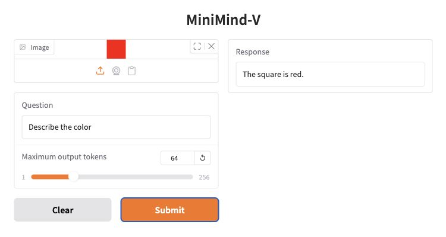

[](https://github.com/Zaynmagic/Zayn-s-minimindv/actions/workflows/tests.yml) [](LICENSE) [](requirements.txt)

# MiniMind-V

**Vision-language model · PyTorch · SigLIP2**

A single-image VLM combining [MiniMind](https://github.com/Zaynmagic/Zayn-s-minimind) with a frozen SigLIP2 encoder and a two-layer MLP projector. The full configuration has **67.1M parameters in the language model and projector** (63.9M + 3.15M). The frozen vision encoder adds 94.6M parameters and is counted separately.

## Gradio demo

**Synthetic pipeline demo:** [the tiny configuration](configs/tiny.json) has 571,232 parameters and uses a randomly initialized, frozen vision encoder. The checkpoint at `runs/portfolio-demo/hf` was fitted to four colored-square training images; it demonstrates the image-to-answer pipeline, not the full 67.1M configuration's quality on real-world images.



*Local Gradio capture: the tiny fixture model answering "Describe the color" about the red training square.*

The browser demo and CLI share the same prediction function. [Reproduction commands](#evaluation) below generate the checkpoint and launch the local interface.

## Example outputs

Actual greedy responses from `inference.py` using the same tiny checkpoint. All three images are training fixtures.

| Image | Question | Actual answer |
| --- | --- | --- |
|  | Describe the color. | The square is red. |
|  | Describe the color. | The square is green. |
|  | Describe the color. | The square is blue. |

```bash
python inference.py --model runs/portfolio-demo/hf \
  --image data/synthetic/images/red.png --question "Describe the color." \
  --max-new-tokens 32 --device cpu
```

## Evaluation

| Tiny-model check (training fixtures) | Result |
| --- | ---: |
| Assistant-token cross-entropy | 0.005722 |
| Assistant-token perplexity | 1.005739 |
| Answers matched | 4 / 4 |

Evaluated after training across 50 supervised assistant tokens, following 400 alignment and 400 SFT updates on CPU. All four images were used for training, so these are **in-sample checks**, not a held-out VQA benchmark. [All four outputs, CLI commands, and run details](docs/demo-results.json).

<details>
<summary>Reproduce the demo and measurements on CPU</summary>

```bash
python -m pip install -r requirements-demo.txt
python -m training.run --config configs/tiny.json \
  --allow-random-llm --allow-random-vision \
  --steps 400 --batch-size 4 --length 64 --lr 0.001 --seed 42 \
  --device cpu --output runs/portfolio-demo
python -m examples.evaluate_fixture --model runs/portfolio-demo/hf \
  --output runs/portfolio-demo/evaluation.json
python demo.py --model runs/portfolio-demo/hf --port 7860
```

Open `http://127.0.0.1:7860`, upload `data/synthetic/images/red.png`, and ask `Describe the color.` The demo stays local; add `--device cuda` to its launch command for GPU inference. Weights are generated locally; numerical results can vary slightly across environments.

</details>

## Project overview

| Area | What is implemented | Code |
| --- | --- | --- |
| Vision-language architecture | Frozen SigLIP2 features, a 768 → 2048 → 768 projector, and the MiniMind decoder | [Vision-language model](model/model_vlm.py), [full config](configs/64m.json) |
| Two-stage training | Projector alignment with a frozen LLM, followed by instruction tuning of the LLM and projector | [Stage configuration and training](training/run.py), [image/chat preprocessing](training/data.py) |
| Training and inference | AMP, gradient accumulation, DDP, KV caching, and PyTorch SDPA attention | [Training loop](training/run.py), [attention and decoding](model/model_minimind.py) |
| Model delivery | Gradio image/question demo, CLI inference, and self-contained Hugging Face exports | [Gradio demo](demo.py), [CLI](inference.py), [export](training/run.py) |

This version uses a wider projector, requires one contiguous image span per example, and keeps the vision encoder frozen in both stages. Exports bundle the encoder, processor, tokenizer, and model code so they can be moved without local path dependencies. PyTorch SDPA can use FlashAttention on supported CUDA setups.

Architecture and tokenizer foundations are adapted from [MiniMind-V](https://github.com/jingyaogong/minimind-v) and [MiniMind](https://github.com/jingyaogong/minimind). See [NOTICE](NOTICE) and [LICENSE](LICENSE).

## Setup

Python 3.10+. Install PyTorch for your hardware, then:

```bash
python -m pip install -r requirements-dev.txt
python -m pytest -q
python -m training.run --allow-random-llm --allow-random-vision --steps 6
```

The default tiny model and colored-square data are only for checking the pipeline. Runs save `align.pt`, `sft.pt`, `metrics.json`, and a portable Hugging Face export under `runs/smoke/hf/`. For training without tests, install `requirements.txt` instead.

## Training

The data directory needs `align.jsonl`, `sft.jsonl`, and their images. Each row starts with a user message containing one `<image>` placeholder; image paths are relative to the JSONL file:

```json
{"image":"images/example.jpg","conversations":[{"role":"user","content":"<image> Describe the scene."},{"role":"assistant","content":"A dog running across grass."}]}
```

Use a matching checkpoint from [Zayn's MiniMind](https://github.com/Zaynmagic/Zayn-s-minimind) and a pretrained vision encoder:

```bash
python -m training.run \
  --config configs/64m.json \
  --vision-source jingyaogong/siglip2-base-p32-256-ve \
  --vision-revision 9465d1dc89db6bc6227c5b6b0e0ca9b940325d62 \
  --llm-checkpoint ../Zayn-s-minimind/runs/dense/sft.pt \
  --data /path/to/image-corpus \
  --steps 10000 --batch-size 4 --length 512 \
  --precision bf16 --output runs/full
```

`--steps` counts microbatches per stage; `--accumulation` groups them into optimizer updates. `--stages align` or `--stages sft` selects one stage. Increase `--length` if image tokens or assistant targets are truncated. BF16 needs hardware support; FP16 requires CUDA.

For a tiny companion checkpoint, use `--llm-checkpoint ../Zayn-s-minimind/runs/smoke/sft.pt --allow-random-vision` with the default config. Two-process CPU training:

```bash
python -m torch.distributed.run --standalone --nproc_per_node=2 \
  -m training.run --allow-random-llm --allow-random-vision \
  --steps 3 --accumulation 2 --output runs/ddp-check
```

## Inference

```bash
python inference.py --model runs/smoke/hf \
  --image data/synthetic/images/red.png --question "What color is the square?"
```

The CLI uses greedy decoding. Add `--device cuda` for GPU inference or `--max-new-tokens 128` to change the output limit. Exports include the vision weights, processor, tokenizer, and custom model code, so load only exports you trust.
